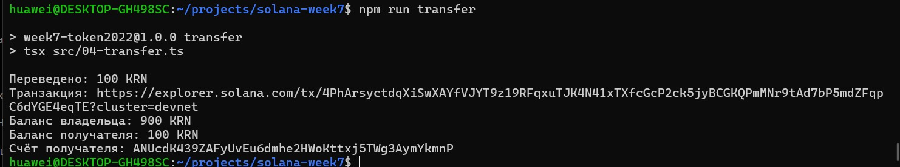
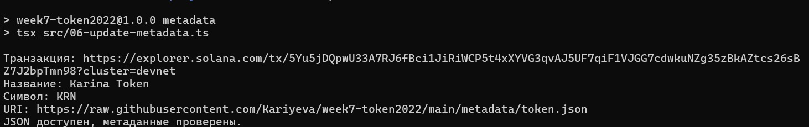
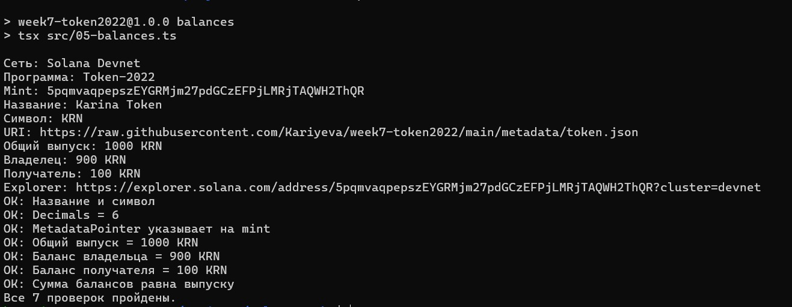

# Задание 7. SPL Tokens и Token Extensions

В работе создан токен Karina Token (KRN) в Solana Devnet через Token-2022. Клиент написан на TypeScript.

## Результат

- Название: Karina Token
- Символ: KRN
- Decimals: 6
- Выпущено: 1000 KRN
- Переведено второму кошельку: 100 KRN
- Итоговые балансы: 900 KRN и 100 KRN

Mint: `5pqmvaqpepszEYGRMjm27pdGCzEFPjLMRjTAQWH2ThQR`

[Токен в Explorer](https://explorer.solana.com/address/5pqmvaqpepszEYGRMjm27pdGCzEFPjLMRjTAQWH2ThQR?cluster=devnet)

## Метаданные

Использованы расширения MetadataPointer и TokenMetadata. MetadataPointer указывает на сам mint, где хранятся название, символ и URI.

Описание токена размещено в [metadata/token.json](metadata/token.json).

URI:
https://raw.githubusercontent.com/Kariyeva/week7-token2022/main/metadata/token.json

При обновлении URI клиент рассчитывает дополнительную сумму SOL, необходимую для хранения увеличенных метаданных.

## Транзакции Devnet

- [Выпуск 1000 KRN](https://explorer.solana.com/tx/38hSQ82yarNZFfupwWXgvBa8EZT2TxZ2d5GPkcCbfoVLirmRBasZymFFpbRtQx4LgFUJC4C32W2aZ22FP69ZoYAu?cluster=devnet)
- [Перевод 100 KRN](https://explorer.solana.com/tx/4PhArsyctdqXiSwXAYfVJYT9z19RFqxuTJK4N41xTXfcGcP2ck5jyBCGKQPmMNr9tAd7bP5mdZFqpC6dYGE4eqTE?cluster=devnet)
- [Обновление URI](https://explorer.solana.com/tx/5Yu5jDQpwU33A7RJ6fBci1JiRiWCP5t4xXYVG3qvAJ5UF7qiF1VJGG7cdwkuNZg35zBkAZtcs26sBZ7J2bpTmn98?cluster=devnet)

Публичные результаты выполнения сохранены в папке `receipts`.

## Файлы клиента

- `01-create-wallets.ts` — создание или загрузка двух кошельков, проверка SOL.
- `02-create-mint.ts` — создание mint и метаданных.
- `03-mint-tokens.ts` — выпуск 1000 KRN на токеновый счёт владельца.
- `04-transfer.ts` — перевод 100 KRN с проверкой decimals.
- `05-balances.ts` — чтение балансов и семь проверок результата.
- `06-update-metadata.ts` — обновление URI и проверка внешнего JSON.
- `common.ts` — подключение к Helius Devnet и работа с локальными ключами.

## Запуск

Требуется Node.js 22 и npm.

```bash
npm ci
cp .env.example .env
```

В `.env` нужно указать собственный RPC URL Helius для Devnet.

```bash
npm run check
npm run wallets
```

После пополнения первого кошелька тестовыми SOL:

```bash
npm run mint-create
npm run mint-tokens
npm run transfer
npm run metadata
npm run balances
```

Приватные ключи не входят в репозиторий. При запуске на новом компьютере создаются новые кошельки и новый mint. Приведённые выше адреса и транзакции относятся к выполненной работе.

Повторный выпуск и перевод пропускаются при ожидаемых итоговых значениях. При других балансах клиент останавливается для проверки.

## Проверка

`npm run check` завершился без ошибок.

`npm run balances` проверяет название и символ, decimals, MetadataPointer, общий выпуск, оба баланса и равенство их суммы общему выпуску. Все семь проверок пройдены. Команда `npm run metadata` дополнительно проверяет доступность JSON и сохранённый URI.

При установке зависимостей npm сообщил о 9 уязвимостях: 6 moderate и 3 high. Они пока не устранены; проект использовался с отдельными учебными кошельками в Devnet.

## Скриншоты




